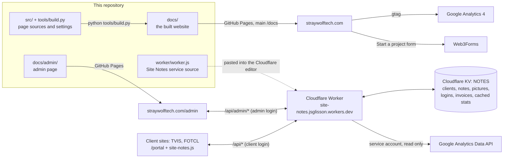

# Stray Wolf Technology

The website for Stray Wolf Technology (https://straywolftech.com), plus the private tools behind it:
the admin page and the Site Notes service that client websites use to send change requests.

New here? Read this file, then [`worker/README.md`](worker/README.md) for the service, then
[`SYNC.md`](SYNC.md) for what is in progress right now. Past versions are in [`CHANGELOG.md`](CHANGELOG.md).

## How it fits together

| Piece | Where it lives | Runs on |
|---|---|---|
| Public website | `src/` and `tools/build.py`, built into `docs/` | GitHub Pages from `main` `/docs`, domain `straywolftech.com` (DNS at Cloudflare) |
| Admin page | `docs/admin/index.html` (hand-written, not built) | GitHub Pages, at `/admin`. Hold the moon in the site header to get there. |
| Site Notes service | `worker/worker.js` (one file) with tests in `worker/` | Cloudflare Workers, pasted in by hand. See [`worker/README.md`](worker/README.md). |
| Client portals | Each client's own repository: `jsglisson3/TVIS-Site-Work-and-Construction` (`src/assets/site-notes.js`, `src/notes/index.html`) and `jsglisson3/FOTCL` (`site-notes.js`, `portal/index.html`) | Each client's site, at `/portal` |

`site-notes.js` is the same file, byte for byte, in every client repository. Anything that differs per client
is a `data-` setting on its `<script>` tag (see the comment at the top of the file).

## Folders

| Path | What it is |
|---|---|
| `src/layout.html` | The shell every page shares: head, header, footer. `{{...}}` slots are filled by the build. |
| `src/home.html` | The homepage's order of sections. Each section is built in `tools/build.py`. |
| `src/pages.py` | Work, Pricing, Reviews, About, Start a project, Thanks, Privacy, Terms, 404. |
| `src/sites.py` | The client websites shown on the Work page and in the homepage carousel. |
| `src/partials/` | The Start a project questions, the How it works scenes, the icon sprite. |
| `tools/build.py` | Builds every page into `docs/`. The settings block at the top holds the domain, `VERSION`, contact details, Google IDs and service areas. It also writes the sitemap, the structured data and each page's Content-Security-Policy hashes. |
| `tools/typeset.py` | Curly quotes and dashes, run by the build. |
| `tools/a11y-check.js` | axe-core accessibility check on every page at phone and desktop widths. |
| `tools/shot.js` | Full-page screenshot of one URL. |
| `tools/make-icons.js`, `tools/og-card.html` | Make the favicons and the share image. Run by hand when the logo changes. |
| `docs/` | The built site. Don't edit the page `.html` files here: edit `src/` and rebuild. `docs/css/site.css` and `docs/js/*.js` are edited directly. |
| `docs/js/site.js` | Header, phone menu, hero, How it works, work carousel, fit check, Start a project form, and the moon door to the admin. |
| `docs/js/analytics.js` | Google Analytics 4 and the few events it sends (`generate_lead`, Start a project clicks, email clicks). Off when `GA4_ID` is empty. |
| `docs/images/brand/`, `docs/images/email/` | The logo kit and the email signature images. Not all are used by the site; they are kept for email and for clients. |
| `worker/` | The Site Notes service, its tests and its docs. |

## Change the website

1. Edit `src/` (words and structure) or `docs/css/site.css` / `docs/js/site.js` (look and behaviour).
2. Run `python tools/build.py`. It rebuilds `docs/` and stops if a `[PLACEHOLDER]` or `[CONFIRM]` tag would reach a page.
3. If `site.css` or `site.js` changed, bump `VERSION` in `tools/build.py` first, so browsers fetch the new files (`?v=`).
4. Open `docs/index.html` to check, then commit. GitHub Pages publishes within a few minutes.

The build is deterministic: running it on an unchanged checkout changes nothing except the sitemap date.

### Add a site to the Work page

Copy one block in `src/sites.py`, put it first, and fill in `name`, `about`, `link`, `image` and `tag`.
Screenshots go in `docs/images/work/` as `<image>-desktop-480/640/960/1440.webp` and `<image>-phone-300/600.webp`. Rebuild.

## Checks

| Check | Command | When |
|---|---|---|
| Site Notes service tests | `node worker/test-worker.mjs` | Every Worker change |
| Build is up to date | `python tools/build.py` then `git status` shows only `docs/sitemap.xml` | Every site change |
| Accessibility | serve `docs/`, then `node tools/a11y-check.js http://localhost:8500` | Before a release |

GitHub runs the first two (plus an HTML check) on every push: see `.github/workflows/checks.yml` and the Actions tab.

## Security notes

- Every built page carries a Content-Security-Policy meta tag with hashes of its inline scripts (computed by the build).
  The admin page is not built, so its policy hashes are kept by hand: change an inline script there and its
  `sha256-...` hash in the meta tag must be recomputed, or the admin page goes blank.
- The repository is public. Keep secrets out of it: the Worker's secrets (`ADMIN_PASSWORD`, `GA_SA_JSON`) live only in Cloudflare.
  The Web3Forms key in `tools/build.py` is a public form key by design.
- GitHub Pages can't send security headers, so the meta tag is the only policy on the public site.
